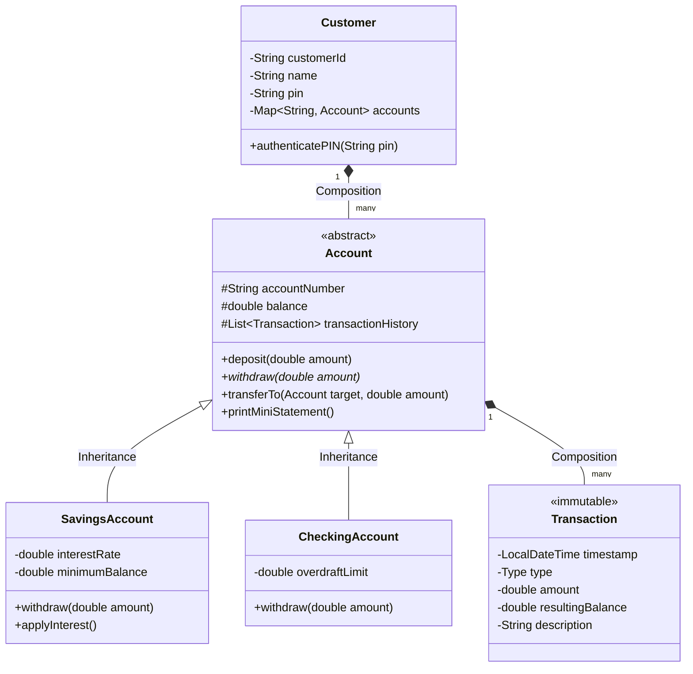

# Task 2: Core Banking & ATM Simulation Engine

## Overview
An interactive core banking engine modeling secure monetary transactions, customer account hierarchies, audit logging, and transactional integrity using object-oriented design and custom Java exceptions.

---

## 🏛️ Architecture & OOP Design Patterns



---

## 🛠️ Key Technical Features
1. **Inheritance & Polymorphism:**
   - Abstract `Account` base class defines standard contracts.
   - `SavingsAccount` overrides `withdraw()` to preserve a minimum balance reserve and provides `applyInterest()`.
   - `CheckingAccount` overrides `withdraw()` to support configurable overdraft lines of credit.
2. **Custom Java Exceptions:**
   - `InsufficientFundsException`: Raised when withdrawal exceeds available liquid funds or overdraft limit. Includes diagnostic balance information.
   - `InvalidPINException`: Raised during failed credential checks; tracks remaining attempts and locks the account after 3 consecutive failures.
3. **Audit Trail & Transaction History:**
   - Immutable `Transaction` log captures timestamps (`LocalDateTime`), transaction types (`DEPOSIT`, `WITHDRAWAL`, `TRANSFER`, `INTEREST_CREDIT`), amounts, and post-transaction balances.
4. **Inter-Account Transfers:**
   - Atomic fund transfer logic guarantees money deducted from the source account is credited into the target account with dual-sided audit records.

---

## 📁 Project Structure
```text
Task2_ATM_Simulation/
├── Account.java                    # Abstract base account
├── SavingsAccount.java             # Subclass with interest & minimum balance
├── CheckingAccount.java            # Subclass with overdraft protection
├── Customer.java                   # Customer profile & PIN verification
├── Transaction.java                # Immutable transaction audit record
├── InsufficientFundsException.java # Custom checked exception
├── InvalidPINException.java        # Custom security exception
├── ATM.java                        # Main interactive CLI simulation
└── README.md                       # Documentation
```

---

## 🚀 How to Compile & Run

### 1. Compile
```bash
javac *.java
```

### 2. Execute
```bash
java ATM
```

### Demo Credentials:
- **Customer ID:** `1001` | **PIN:** `1234` (Aarav Sharma - Savings `SA-1001`, Checking `CA-2001`)
- **Customer ID:** `1002` | **PIN:** `4321` (Diya Patel - Savings `SA-1002`, Checking `CA-2002`)
